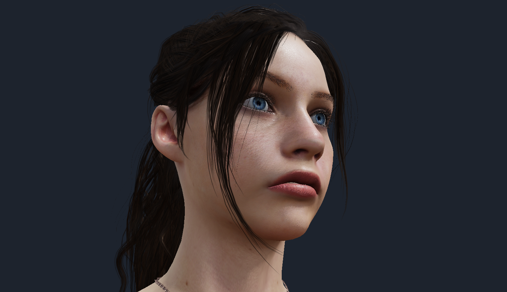
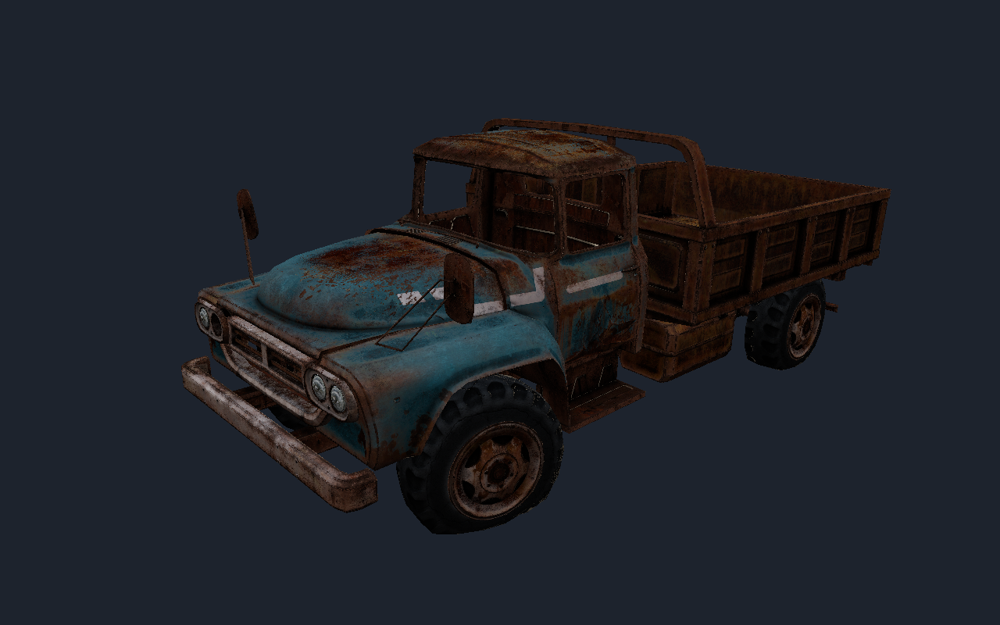
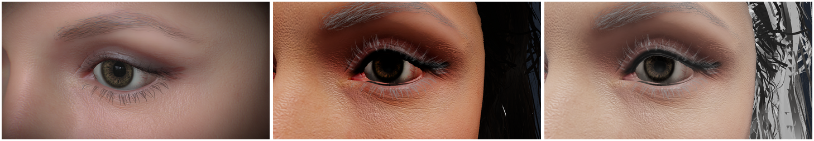
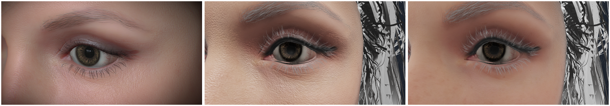

# Centre Stage

A GLB/glTF 2.x viewer in C# — written to understand the format end to end rather than
wrap someone else's loader. Exhibit (the GNOME viewer) is a Python/GTK settings shell over
libf3d/VTK; when VTK's glTF importer refuses a file or ignores an extension, no amount of
Python can intervene. Here the whole pipeline is in reach.




## Layout

```
src/CentreStage.Core/     parsing and scene assembly (no rendering dependencies)
  Glb/GlbFile.cs      GLB container: header, JSON chunk, BIN chunk
  Schema/             typed DTOs for the glTF manifest
  BufferData.cs       buffer -> bufferView -> accessor decode (strides, sparse, normalised)
  GltfModel.cs        loads a file into runtime meshes/nodes/materials/textures/lights/skins
src/CentreStage/   Silk.NET OpenGL 3.3 renderer
  ShaderSources.cs    metallic-roughness PBR + extension shading
  Renderer.cs         geometry upload, CPU skinning, per-material uniforms
  OrbitCamera.cs      orbit/pan/zoom with auto-framing
tests/CentreStage.Core.Tests/  xUnit tests over hand-built in-memory GLBs
```

## Usage

```
dotnet run --project src/CentreStage -- <model.glb>              # interactive viewer
dotnet run --project src/CentreStage -- --inspect <model.glb>    # dump structure, no window
dotnet run --project src/CentreStage -- <model.glb> --capture out.png   # offscreen render
dotnet run --project src/CentreStage -- <model.glb> --dlss-demo outdir  # unattended DLSS seam evidence run
./linux/build-scene-host.sh
CENTRESTAGE_SCENE_LIBRARY="$PWD/src/CentreStage/runtimes/linux-x64/native/libscene_host.so" \
  dotnet run --project src/CentreStage -- <snapshot.glb> --scene-neural-demo <trusted-scene-model.pt>
CENTRESTAGE_SCENE_LIBRARY="$PWD/src/CentreStage/runtimes/linux-x64/native/libscene_host.so" \
  dotnet run --project src/CentreStage -- <snapshot.glb> --face-neural-demo <trusted-face-model.pt>
```

The native inference ABI is built and packaged by `linux/build-scene-host.sh` (or point `CENTRESTAGE_SCENE_LIBRARY` at a built `libscene_host.so`).

`--scene-neural-demo` opens a separate opt-in application view over the same trusted snapshot. Centre Stage draws the locked test-000 view and light twice at 256×256 — once with the full scene shader (the reference) and once with the reduced-fidelity shader (the cheap frame) — and only the cheap frame goes to the locally trained `scene-train` CPU model. The window shows three panels (reference, cheap, neural) with each variant's PSNR against the reference, plus a magnified crop of the head and torso so the change is visible. F10 swaps the cheap and neural panels, Esc closes. The startup log prints the host path, the host's own transform label and the measured PSNRs.

`--face-neural-demo` shows a head-and-shoulders close-up instead: the locked, held-out face frame is drawn twice at 640×640 (full shader and reduced shader), only the cheap frame goes through a face-trained model, and the reference and neural output are shown side by side with a magnified crop of the face and the cheap input beneath. F10 swaps the panels, Esc closes. It needs its own checkpoint: the full-body model is trained on a different framing and light. Both views print the host path, the host's own label and whole-frame PSNR on the held-out frame; `--face-neural-demo` also prints PSNR for a head box and a face-only box.

Both views are scene-specific — the camera, light and asset are fixed, and any other GLB is rejected by SHA-256 — and neither is a general live renderer or DLSS 5. Each reproduces one or two locked held-out frames and produces run-scoped evidence: the PSNR log, `CENTRESTAGE_SCENE_DUMP=<dir>` (captured frames as PPM) and `CENTRESTAGE_WINDOW_DUMP=<file>` (the composed window once, then close) — the last two avoid a screen-capture portal. `CENTRESTAGE_FACE_SWEEP=<n>` with `--face-neural-demo` instead renders the same asset and light from n evenly spaced yaws, writes `sweep-NN.ppm` into the dump directory and exits — an in-app capture for view-dependent defects, since a desktop-capture portal cannot see this window. The training-side records are the run reports in dlss5-linux; on both, PSNR and the lighting proxy improve while the detail-gradient proxy regresses slightly (the small model smooths fine texture).

Mouse: left-drag orbit, middle-drag pan, scroll zoom, double-click or F11 toggles
fullscreen (right-click opens the demo's context menu while the seam is
active, so it no longer pans), F9 processes one frame through the DLSS
seam (see below), F12 saves a
screenshot of the frame just drawn (`CENTRESTAGE_SHOT_DIR`, default `./shots`), Esc quits. The
interactive viewer opens immediately and shows progress ("Parsing",
"Uploading textures n/N", "Closing") via an antialiased TrueType status overlay
(rasterised from a system sans face; a small bitmap font is the last-resort fallback):
parsing and texture decoding run on a background thread, and textures upload
incrementally per frame. Exit codes: 0 on clean close, 2 if the model failed to load.

Diagnostic env vars: `CENTRESTAGE_WIREFRAME=1` (no culling/depth), `CENTRESTAGE_SOLID=1|2`
(solid-colour shaders; mode 2 ignores vertex attributes entirely), `CENTRESTAGE_AUTO_CLOSE_MS=N`
(self-close after N ms — exercises the full open/close lifecycle unattended),
`CENTRESTAGE_STATUS_TEST=1` (with `--capture`: draws the status overlay after the model to
verify overlay text survives the renderer's GL state).

### Multisampling and alpha-to-coverage (opt-in, measured as a regression)

`CENTRESTAGE_MSAA=4` requests a 4-sample window framebuffer (clamped to
`GL_MAX_SAMPLES`; below 2 it is ignored) and enables `GL_SAMPLE_ALPHA_TO_COVERAGE`
plus `GL_SAMPLE_ALPHA_TO_ONE` for the blend pass only. It defaults **off** and the
current single-sample path is unchanged. `--capture`, the viewer and the
`CENTRESTAGE_FACE_SWEEP` path all honour it; the sweep renders through its own
multisampled FBO and blits into the existing single-sample texture, because
`ReadPixels` cannot read a multisampled buffer. The renderer keys
alpha-to-coverage off `glGetIntegerv(GL_SAMPLES)` of the *bound* framebuffer, so
`--scene-neural-demo`, `--face-neural-demo` and the DLSS seam — which render into
their own single-sample RGBA8 FBOs — keep the exact blending they were pinned
against; the pinned frames stay byte-identical (verified with `cmp`, and the PSNRs
reproduce to the decimal).

`CENTRESTAGE_HAIR_COVERAGE=1` (with `--face-neural-demo` and a dump directory)
additionally writes `coverage-NN.pgm`: the alpha channel left by the hair
material's blended primitives composited over the opaque depth, per sweep yaw.
It is a measurement aid, not shading.

Measured on `Teen_Kitty_rigged.glb`, 12 yaws, 640×640
(alpha = hair-only accumulated opacity; "bright in hair" = skin-like pixels
inside the eroded hair silhouette):

| configuration | hair pixels with alpha < 0.95 | p10 | bright in hair |
|---|---|---|---|
| single-sample, current default | 14.2% mean (6.0–27.2%) | 0.51–0.99 | 0.78% mean |
| 4x MSAA, blending only (no A2C) | 14.9% mean (6.7–28.6%) | 0.46–0.99 | — |
| 4x MSAA + alpha-to-coverage | 59.0% mean (37.6–79.2%) | 0.50 | 1.46% mean |

Alpha-to-coverage **does not fix the scalp-through-hair defect on this asset and
makes it measurably worse**: the hair atlas is genuinely semi-transparent
(mean alpha 0.36, ~0.42 held through the mips), so turning per-fragment alpha into
4-level sample coverage replaces smooth layer accumulation with dither, and
samples no card covers reveal the skull. The flag is kept for evaluation, off by
default.

### Hair opacity

The defect this addresses: a hair set is a stack of alpha-painted cards whose
authored alpha composites to well under one, so the bright skin under the
parting shows through and the model looks bald from above. Two levers work on
that axis — how much of what is behind a hair card reaches the screen.

Both levers match **material families by name**: a comma-separated list
(`CENTRESTAGE_BLEND_CUTOUT_MATERIAL` / `CENTRESTAGE_BLEND_BOOST_MATERIAL`,
default `hair,scalp`) is compared against the *tokens* of the material name —
the name split on non-alphanumeric characters, on lower-to-upper transitions and
on letter-to-digit transitions — case-insensitively. Tokens rather than raw
substrings because the boost is on by default: substring matching would also
catch `Chair_Fabric`, `Mohair_Trim` and `Hairpin` and silently thicken an
unrelated material. Under-matching leaves a material as it was; over-matching
alters an asset that never asked for it.

`scalp` is not optional in the default. A hair set names its parts
independently — `Hair_Transparency`, `BabyHair_Transparency` and
`Scalp_Transparency`, the painted cap that hides the skin under the parting — so
matching on `hair` alone drops exactly the part that covers the crown and the
head still shows through every strand. Measured on `Mégane_Blender.glb`: with
`hair` alone the crown stays bald; with `hair,scalp` the cap closes it.

- `CENTRESTAGE_BLEND_BOOST=<k>` remaps blend alpha in the shader to
  `1-(1-a)^k`, folding *k* cards' worth of coverage into each fragment. `k` of 1,
  or outside `(1, 8]`, disables it (an unusable explicit value is reported on
  stdout rather than silently restoring the default). Because `pow(1-a, 1)` is
  not guaranteed to be exactly `1-a`, the shader guards the remap with
  `uAlphaBoost > 1.0` and never evaluates it when the lever is off. **On by
  default at k = 3**; set `CENTRESTAGE_BLEND_BOOST=1` for the raw authored alpha.
- `CENTRESTAGE_BLEND_CUTOUT=<alpha>` draws fragments of the family at or above
  the cutoff as **opaque, depth-writing geometry in a prepass** before the sorted
  blend pass. Dense strand interiors therefore occlude what is behind them, and
  the genuinely thin remainder still blends in order. Depth de-duplicates: the
  same fragment in the blend pass sits at its own depth, fails `GL_LESS`, and is
  not composited twice — so no shader variant is involved. **Off by default**:
  measured on `Mégane_Blender.glb` it deletes most of the hair, because that
  atlas is genuinely soft (alpha max 0.86) rather than a dense cutout.

The two levers can be enabled together; the measurement below reports the
combination as well as each one alone.

`CENTRESTAGE_HIDE_BLEND=<name-list>` skips a blend material family entirely. It
is a measurement aid only: it produces the "no hair" reference used to separate
"the hair is too transparent" from "the hair does not cover that part of the
head".

The neural demo, its frame dumps and the scene-pair captures are **pinned** to
the pre-boost path: those renderers are constructed with `pinnedEvidence: true`,
which keeps `k = 1`. k = 1 is the pre-change shader path, so the locked frames
and the PSNR inputs are unchanged. Verified by byte-comparing all 46
full-body/face pair rasters on 04/11/2026; neural inference itself was not re-run.
The pinned entry points also *reject* `CENTRESTAGE_BLEND_*`
and the other diagnostics outright, so the variable cannot be used to move a
locked frame. Live viewing and `--capture` use k = 3.

### Studio lighting and presentation (04/11/2026, first implementation)

The first studio implementation (commit `aa73b35`; revised defaults in the
follow-up below) uses an asset-independent analytic studio environment:
a neutral room, broad upper softboxes and a subtle cool fill. Diffuse irradiance
and roughness-broadened specular radiance come from the same spherical-Gaussian
lobes; the specular term uses a two-coefficient environment BRDF fit. This is a
**procedural IBL approximation**, not Sketchfab's HDR cubemap, not an exact GGX
prefilter and not a BRDF LUT. It requires no external/licensed environment file
or additional texture units. The supplied LUV binaries were not decoded; their
orientation/encoding was not guessed. Authored punctual lights remain additive.

Exposure (stops) precedes the existing ACES-like fit, followed by sRGB grading:
saturation, gamma contrast and a black/white-preserving midtone brightness lift.
These controls deliberately do **not** claim numerical equivalence with
Sketchfab's proprietary default tone curve. There is no vignette, sharpen,
colour-balance, SSAO, SSR or TAA pass yet. Unlit materials retain authored colour.
The shader variant is constructed separately: the pinned full/cheap sources do
not acquire the studio functions or grading.

An optional **skin diffusion approximation** matches material-name tokens using
the same family matcher as hair (default `skin`, so `SkinHead` matches but
`SkinnyJeans` does not). It softens diffuse lighting normals, broadens the
environment specular lobe and weakens baked micro-occlusion; it does not blur the
colour atlas. This is not profile/thickness-based SSS or recovered Sketchfab
metadata. It cannot reproduce the captured SSS factor 76.1. No ripper or asset
was changed. Disable or explicitly select families when the name heuristic is
inappropriate; hair receives no skin treatment by default.

| new variable | default | valid values / meaning |
|---|---|---|
| `CENTRESTAGE_PRESENTATION` | 1 | 0 restores the starting hemispheric/tonal path; 1 enables studio |
| `CENTRESTAGE_ENV_INTENSITY` | 0.8 | [0,16], linear environment multiplier; 0 removes environment lighting |
| `CENTRESTAGE_ENV_ROTATION` | 0 | [-360,360], yaw degrees around world +Y |
| `CENTRESTAGE_EXPOSURE` | 0 | [-8,8], exposure stops, +1 doubles pre-map radiance |
| `CENTRESTAGE_BRIGHTNESS` | 0.04 | [-0.5,0.5], midtone lift `4*b*c*(1-c)` |
| `CENTRESTAGE_CONTRAST` | -0.12 | [-1,1], display exponent `max(1+c,0.01)` |
| `CENTRESTAGE_SATURATION` | 0.65 | [0,2], display RGB interpolation from Rec.709 grey |
| `CENTRESTAGE_SKIN_DIFFUSION` | 0.8 | [0,1], 0 disables skin approximation |
| `CENTRESTAGE_SKIN_MATERIAL` | skin | comma-separated name tokens; empty disables matching |

Numbers use invariant culture. Invalid/non-finite/out-of-range values warn and
fall back to the documented default. Startup logs the effective settings.
All nine variables are rejected (even `PRESENTATION=0`) by the pinned pair
captures and both neural demos, as are the retained hair controls.

**Measured eye comparison**, sRGB bytes, GLB MD5
`f79c7958c1a64c02f916f87895862a9d`. Reference is the supplied
`/home/michael/Downloads/una-sketchfab-reference/compare/sf-render.png`.
Starting build means the inherited uncommitted tree, including its corrected
transmission and hair boost, before this presentation work.

| configuration | grey mean | grey sd | HSL saturation | mean RGB |
|---|---:|---:|---:|---|
| supplied Sketchfab reference | 0.719813 | 0.062415 | 0.198192 | (0.538788, 0.418891, 0.385368) |
| supplied earlier Centre Stage reference | 0.650863 | 0.092108 | 0.439307 | (0.424608, 0.246738, 0.189070) |
| starting build, frozen capture below | 0.649112 | 0.142073 | 0.391703 | (0.438910, 0.280425, 0.217189) |
| studio defaults, same frozen capture | **0.732927** | **0.129566** | **0.200679** | **(0.547893, 0.453168, 0.411411)** |

Absolute mean-grey error falls 80%, saturation error 99%, Euclidean mean-RGB
error 82%; sd error falls only 16%. These are aggregate colour statistics,
**not aligned-image similarity**. The new capture is not precisely registered
to Sketchfab: more hair/background and a different projection remain. The eye
is still darker, sclera/lashes and pore contrast harsher, and global sd is still
2.08 times the reference. The studio is not Urban Exploring Interior; normal
softening is not spatial SSS. Do not interpret the colour gains as a visual match.



Reproduce the frozen view (yaw 90 is +Z in this camera, not yaw 0):

```sh
# Actual solution name is .slnx, not .sln.
dotnet build CentreStage.slnx
dotnet test
CENTRESTAGE_CAMERA="350,16700,775,800,75,0" dotnet run --no-build --project src/CentreStage -- \
  /home/michael/Downloads/Una-109b3c7b/Una.glb --capture after.png
CENTRESTAGE_PRESENTATION=0 CENTRESTAGE_CAMERA="350,16700,775,800,75,0" \
  dotnet run --no-build --project src/CentreStage -- \
  /home/michael/Downloads/Una-109b3c7b/Una.glb --capture before.png
# Fixed centre crop: 1280/661 = 1.9365, matching the actual 1036/535 reference
# (the brief's approximate 1.81 aspect does not describe sf-render.png).
magick after.png -crop 1280x661+0+69 +repage crop.png
magick crop.png -colorspace Gray -format "%[fx:mean] %[fx:standard_deviation]\n" info:
magick crop.png -colorspace HSL -channel G -separate -format "%[fx:mean]\n" info:
magick crop.png -resize 1x1! -format "%[pixel:p{0,0}]\n" info:
```

`Gray` here is the output of the supplied ImageMagick conversion, not a claim
of linear radiometric luminance. RGB uses its supplied resize-to-one command,
including alpha/filter handling. These are deliberately the same measurement
conventions as the reference; the mean-grey value must not be inferred from
the reported resize-to-one RGB tuple.

Single-control ablations, identical frozen camera/crop, all other defaults held:

| override | grey mean | grey sd | HSL saturation |
|---|---:|---:|---:|
| defaults | 0.732927 | 0.129566 | 0.200679 |
| `ENV_INTENSITY=0` | 0.621162 | 0.135482 | 0.206899 |
| `ENV_ROTATION=90` | 0.738101 | 0.133035 | 0.207219 |
| `EXPOSURE=1` | 0.805504 | 0.137817 | 0.229715 |
| `BRIGHTNESS=0` | 0.716726 | 0.126107 | 0.195782 |
| `CONTRAST=0` | 0.713360 | 0.129297 | 0.206251 |
| `SATURATION=1` | 0.732440 | 0.129467 | 0.303515 |
| `SKIN_DIFFUSION=0` | 0.732621 | 0.129573 | 0.200189 |

Names above omit the `CENTRESTAGE_` prefix. Diffusion's aggregate effect is
small on this framing: the bulk of the measured improvement is the environment
and grading, not a claim of recovered SSS. No sharpening was added to already
excessive pore contrast; no extra AO was added to already dark eye recesses.

**Verification:** 202 tests pass (112 baseline, 90 new settings/shader cases),
zero build warnings/errors. Independent read-only review passed after fixing
transmission emission, gamma-space compositing, fallback mapping, material F90,
clearcoat roughness and shared diagnostic rejection. The existing in-progress
hair boost/token matcher, opaque backdrop transmission fix, emissive diagnostic
and capture camera override were retained, not reverted.
The presentation-off PNG is byte-identical to the
starting binary at this view. All **46 pinned PPM rasters** (24 full-body, 22
face, including cheap and full) compare byte-identical to the starting build
on this driver. Both demos and both pair entry points reject 13 tested override
names (52 subprocess checks) before any GL/inference work; dummy checkpoint
used only for rejection, never loaded. Neural inference/PSNR was not rerun.
A second-model Teen Kitty default capture completes without GL errors; this
is a smoke check, not an independent aesthetic acceptance test.
`linux/install.sh` completed; a published Release eye capture is byte-identical
to the verified Debug capture, so the desktop copy is not stale.

Captured transmission in the studio variant composites in display-linear light
after grading, so the backdrop is not graded twice. Emission on clear glass is
mapped separately and added to that branch (an explicit approximation). A
synthetic emissive-glass regression at exposure +8 gives centre RGB (204,48,56)
versus (29,35,45) without emission; it does not vanish against a saturated
hypothetical opaque surface. The legacy/failed-capture fallback stays before
mapping. The retained transmission limits below still apply. Raw local evidence
and pinned hash comparisons are in ignored `.evidence/sketchfab-look/`.

### Follow-up: environment-only lighting (04/11/2026)

The first studio implementation above still received the renderer's automatic
**2.5-intensity directional key** on every model without authored lights. This
was not shown by the GLB's `lights: 0` diagnostic, and it contradicted the supplied
Sketchfab scene's environment-only lighting. That hard key was a major source of
the harsh normal-map/pore contrast; normal softening alone barely affected it.

Studio mode now defaults to **no synthetic punctual light**. Authored glTF lights
are still honoured, and legacy/pinned renderers retain their original key exactly.
No shaders, textures, per-material settings or skin heuristic were changed in
this follow-up. Studio intensity is rebalanced to **1.12** (previously 0.8),
and saturation to **0.73** (previously 0.65). The earlier tables describe the
first implementation, not these new defaults.

New diagnostic: `CENTRESTAGE_FALLBACK_LIGHT=<n>`, default **0**, finite range
**[0,16]**. It sets the synthetic directional key intensity **only in studio mode
and only when the scene has no authored lights**. It does not scale authored
lights. Invalid values warn and use zero. Startup reports `fallbackKey`; all
four pinned entry points reject the variable even if set to zero. Presentation
off ignores it and retains 2.5. To reproduce the previous studio build exactly:

```sh
CENTRESTAGE_FALLBACK_LIGHT=2.5 CENTRESTAGE_ENV_INTENSITY=0.8 \
  CENTRESTAGE_SATURATION=0.65 CENTRESTAGE_CAMERA="350,16700,775,800,75,0" \
  dotnet run --no-build --project src/CentreStage -- \
  /home/michael/Downloads/Una-109b3c7b/Una.glb --capture previous-studio.png
```

Same frozen camera, crop and ImageMagick commands as above; no framing changes:

| configuration | grey mean | grey sd | HSL saturation | mean RGB |
|---|---:|---:|---:|---|
| Sketchfab reference | 0.719813 | 0.062415 | 0.198192 | (0.538788, 0.418891, 0.385368) |
| first studio build (`aa73b35`) | 0.732927 | 0.129566 | 0.200679 | (0.547893, 0.453168, 0.411411) |
| key removed only, previous intensity/saturation | 0.682671 | 0.104177 | 0.168531 | (0.446809, 0.351467, 0.317533) |
| environment-only, rebalanced defaults | **0.719022** | **0.112090** | **0.190242** | **(0.531513, 0.421423, 0.378563)** |

Against the first studio build, absolute mean-grey error falls 94%, mean-RGB
Euclidean error falls 77%, and sd falls 13.5%; saturation error grows from
0.0025 to 0.0080. These are colour statistics, not a claim of registered image
similarity. Compared with Sketchfab, sd remains **1.80×** too high. The sclera,
lashes and iris contrast still differ, as do projection and the environment;
this does not supply the missing spatial SSS or reproduce Sketchfab exactly.



Follow-up verification: **214 tests passing**, zero build warnings/errors;
**46 pinned PPMs byte-identical** to the preceding build; presentation-off PNG
and restored-first-studio PNG each byte-identical to their corresponding saved
baselines. All four pinned entry points reject the new variable. A synthetic
quad with an authored directional light captures identically with fallback 0
and 16, confirming that this lever leaves authored lighting alone. A new
Teen Kitty capture completes as a second-model smoke check. Independent
read-only review passed. `linux/install.sh` completed, and the published Release
capture is byte-identical to Debug. Raw captures/logs are in ignored
`.evidence/sketchfab-followup/`. No neural inference/PSNR was rerun.

### Transmission

`KHR_materials_transmission` used to mix towards the sky colour, which made any
transmissive surface in front of geometry — a cornea over an eye, a window over a
room — an opaque near-white dome. The extension's own model is that the surface
does not block what is behind it, so the shader now samples the backdrop.

The opaque pass is split: everything non-transmissive draws first (depth on), the
colour buffer is copied (blitting, so a multisampled window resolves), then the
transmissive primitives draw against that copy. The sample is offset along the
view-space normal's screen direction, which is zero for a head-on surface — a flat
window is a clean see-through, and the bend is strongest at the rim of a curved
shell where refraction is strongest in reality — and tinted by `baseColor`, the
extension's attenuation. The copy is sRGB-encoded, so the shader decodes before
mixing in linear space; the presentation-off path maps that backdrop a second time. The studio variant
composites after mapping instead (see above).

Measured on the re-exported `Una.glb`, hair hidden, eye-framed, 1280×800: the
fraction of the eye band above 170 luma falls from **36.9%** to **0.24%**, and the
whole frame from 2.9% to 1.3%. With the transmissive primitives removed entirely
(`CENTRESTAGE_HIDE_TRANSMISSIVE=1`) the band measures luma 115 against the new
path's 113, so the cornea is now a faithful window rather than a white dome; the
residual is `baseColor` 0.8 attenuation plus the rim's refraction offset (0.12% of
pixels, all at the rim). `CENTRESTAGE_LEGACY_TRANSMISSION=1` restores the sky-tint
path, and on Mégane and the default Una view the two builds are byte-identical
(neither has transmissive materials visible there; Una's default framing is the
whole model at 6193 units, where the eyes are far below a pixel).

- `CENTRESTAGE_REFRACTION_SCALE=<n>` sets the screen offset along the normal, as a
  fraction of the smaller viewport side, in [0, 0.2]. Default 0.02. Zero makes
  every transmissive surface a flat window; large values distort at the rim of a
  shell. An unusable explicit value is reported and the default is used.
- `CENTRESTAGE_LEGACY_TRANSMISSION=1` restores the pre-change sky tint (the
  diagnostic A/B path).
- `CENTRESTAGE_HIDE_TRANSMISSIVE=1` skips transmissive primitives altogether, to
  see what a glass surface is covering.

Known limits: blended geometry behind glass is not in the copy (it draws after,
in sorted order, and depth-tests against the glass); multiple glass layers do not
refract each other; a transmissive material in `alphaMode: BLEND` keeps the sky
tint; there is no IOR bend, so a thick lens magnifies nothing.

`CENTRESTAGE_CAMERA="x,y,z,distance,yawDeg,pitchDeg"` (capture only) aims the
capture camera at a fixed pose instead of the bounding-box fit, so a detail the
fit cannot reach — an eye, a fitting — can be compared across builds on exactly
the same view. It does not affect the viewer or the pinned demo captures.

### Emissive diagnostic

`CENTRESTAGE_NO_EMISSIVE=1` drops every material's emissive term, to separate
"the glTF says this surface glows" from "the renderer mishandles emissive". An
exporter that writes `emissiveFactor: [1,1,1]` over a reflection map makes a
near-black surface render pale; zeroing that factor in the file and setting this
variable produce the same frame (verified pixel-identical on `Una.glb`, five
views). Off by default; a correct asset is shaded exactly as before.

Measured on `Teen_Kitty_rigged.glb`, default framing, 1280×800, over the hair
footprint (15,201 px, defined as wherever a near-opaque render differs from the
pre-boost render). Lower mean luma means less of the bright scalp behind the hair
is reaching the screen:

| configuration | mean luma | p10 | edge energy |
|---|---|---|---|
| pre-boost default | 42.10 | 24.7 | 8.13 |
| cutout 0.5 | 40.12 | 18.3 | — |
| cutout 0.4 | 39.74 | 17.3 | 10.21 |
| boost 3 (shipped default) | 39.60 | 17.7 | 10.91 |
| cutout 0.4 + boost 3 | 39.55 | 18.0 | 10.03 |
| boost 8 (near-opaque reference) | 39.12 | 15.0 | 12.09 |

`boost 3` lands within 0.48 luma levels of the near-opaque reference, so it
removes essentially all of the transparency bleed, and edge energy *rises*
(8.13 → 10.91): the strands gain contrast, they are not flattened into a mask.
The combination buys a further 0.05 luma levels for the cost of the extra
opaque prepass, which is why only the boost is on by default.

Scope, measured rather than assumed: in the scalp band above the face only
**6.6%** of the bright surface is uncovered by any hair fragment, so transparency
is the dominant mechanism here and an alpha-space fix is the right lever. (An
earlier pass over the whole head reported 40%; that mask included the face, where
of course no hair is drawn — the 6.6% figure is the one that applies.) Unverified
at other orbit angles: the 12-yaw sweep was not re-run for this change.

The table and the coverage figure above were measured with
`CENTRESTAGE_BLEND_BOOST=1` and the old prefix mask (`hair*`), which is not the
mask the shipped default now uses (`hair,scalp` over name tokens). They compare
levers against each other, which is what they were for; they are not a
measurement of the current default's absolute numbers.

Re-measuring them needs the face checkpoint, `CENTRESTAGE_FACE_SWEEP=<n>` and a
dump directory, with `CENTRESTAGE_HAIR_COVERAGE=1` for the coverage maps; the
sweep's renderers are already pinned to k = 1. The checkpoint is not on this host,
so these numbers are historical rather than re-runnable here, and the sweep was
not re-run for this change.

## Desktop integration (GNOME) — open from Files

`linux/install.sh` publishes the viewer to `~/.local/share/centrestage`, installs a
`.desktop` entry and icon, and makes Centre Stage the default handler for `.glb`/`.gltf`
(**double-click a .glb/.gltf in the Files application opens it here**).
Launching Centre Stage with no arguments opens a file picker.
Re-run the script after pulling changes; it is idempotent — and required after
every change, or Files launches stale code. It also builds the native seam
library and ships it with the publish, and copies the demonstration models
into `~/.local/share/dlss5-demo` (the app's first model-search path) when
they exist in the dlss5-linux checkout — without them the install warns and
the app runs with the classical demo only.

The desktop entry launches forced onto X11/XWayland
(`XDG_SESSION_TYPE=x11 WAYLAND_DISPLAY=wayland-none`, the same recipe as
`linux/run-centrestage.sh`): under native Wayland the compositor owns
window placement and the window lands wherever it decides (on this
two-display setup, usually the wrong screen). Verified unattended
(30/10/2026, evidence in `.evidence/files-launch/`): a `gio open` launch
(what Files runs) opens the published app as an X11 client, the window
maps at (50,50) on the Dell primary display (`xdotool getwindowgeometry`
output in `launch-geometry.txt`), it renders the model
(`shot-...png`, an F12 framebuffer capture), and the same published build
processes an F9 demo frame end to end (`published-demo.log`: model loaded,
12.19 s, label recorded).

## DLSS seam (dlss5-linux native host — demonstration transform, NOT DLSS5)

An optional seam wires the tested C host ABI of the dlss5-linux project
(`vr/native-host.h`, built into `libdlss5_nr_host.so` by
`linux/build-native-host.sh`; `DLSS5_LINUX=/path/to/dlss5-linux` selects the
checkout): the current view is rendered into a low-resolution framebuffer (the
seam's capture geometry), read back, processed on a worker thread, and the returned
frame is presented fullscreen with the view name in the status text (the
transform label is recorded in the demo report and console - see the
label policy below).

By default the seam runs the **neural demonstration transform** (NOT
DLSS5): a real learned upscaler with real openly licensed weights
(EDSR-base x2, Apache-2.0; dlss5-linux's `vr/NATIVE-DEMO-UPSCALE.md`) behind
the identical ABI/capture/present path. Geometry (the seam's knob): a
**half-window capture upscaled x2** (640x400 -> 1280x800 at the default
window); the earlier 64x72 x4 capture is imperceptible (Michael's F9
verdict) and stays available as the "extreme" stress case
(`CENTRESTAGE_DLSS_EXTREME=1`; `CENTRESTAGE_DLSS_SYNTHETIC=1` selects
the synthetic pipeline at 64x72). **F10 cycles the presented result
through the A/B views at the SAME capture** (one capture, re-processed):
neural -> plain stretch baseline (bilinear) -> classical sharp stretch
(Lanczos3). The transform label names the actual path and is **recorded with every
presented frame** (demo report + console): "not DLSS5 - demonstration
transform with real weights (EDSR-base x2, Apache-2.0)" on the neural
path, "not DLSS5 - classical demonstration scaler (...)" on the two
classical views, "synthetic weights - arbitrary transform" in synthetic
mode. The phrase "real weights" belongs only to the
neural path. This proves the platform end to end; it is NOT a DLSS5
quality claim and must never be conflated with one.** Processing is
frame-by-frame (F9-triggered) by design; the neural evaluate is ~11 s at
this geometry (the classical views are milliseconds).

**Mouse controls** (the demo runs from the mouse alone): an
**ENLARGE THIS VIEW (F9)** button sits at the top-right of the window -
state-aware, so it becomes **NEXT COMPARISON VIEW (F10)** and **BACK TO
LIVE VIEW** while a result is pinned, **WORKING...** while a frame is in
flight and **TRY AGAIN (F9)** after a failure. **Right-click anywhere**
opens the same controls as a context menu. Screen policy: the app carries
**no "not DLSS5" banner** (Michael's UI preference) - the presented state
names the view and what happened to the pixels; the transform label
("not DLSS5 - demonstration transform with real weights (EDSR...)") is
**recorded in the demo report and console**, never bannered on screen.

**The HUD explains itself in plain words** (a first-time viewer needs no
docs): the live view says what F9 does; the in-flight state reads "view
captured at half resolution - enlarging it now"; the presented state
names the view ("neural upscaler result" / "plain stretch baseline" /
"classical sharp stretch") and says what happened to the pixels.

**Test asset and framing** (this section's evidence): the subject is
`Teen_Kitty_rigged.glb` (Michael's choice after the pixel-girl assets
proved unreadable); the demo runs frame a documented **detail framing -
the top 35% of the model's height** (for a character: face, hair,
shoulders - the region where upscaling differences are visible; the
whole-body framing wastes the frame on dark background and an earlier
whole-car trial measured only a 2.1% A/B difference). The app's normal
view still frames the whole model (framing policy unchanged; the fit
itself changed - see below).

Camera fit note: the viewer now frames models with a projected-extent
fit (the model fills the view at the default pose; the old bbox-diagonal
fit left long models small). Orbiting far from the default pose can clip
extremes - zoom out. Near/far planes track the zoom distance.

Measured on that evidence (`.evidence/dlss-demo-edsr/report.txt`): the
neural result keeps **66%** of the live render's fine detail where the
classical sharp stretch keeps 14% and the plain stretch 6% (detail
energy = the Laplacian of the luminance in the pre-declared centre crop,
normalised to the live render). The accuracy scores favour the classical
views (SSIM 0.9792 sharp vs 0.9658 neural): blurring scores well against
a smooth reference - both numbers are reported rather than the flattering
one, and the zoom strip in `composite.png` shows what they mean. (Runs
drift by a few points with the slowly orbiting camera; each run's
`report.txt` is its own record.)

The synthetic network path remains available (the mode-off fallback,
`dlss5_nr_set_demo_transform(handle, 0)`): same-extent frames, temporally
sequenced, with `dlss5_nr_label()` = "synthetic weights — arbitrary
transform" — the synthetic weights really do make that transform
arbitrary (it rails some channels). It costs seconds per frame (measured
**8.7 s** worker wall-clock at the 64x72 demo geometry on an idle RTX
4070 Ti SUPER; ~10.8 s capture-to-presented). The synthetic path refuses frames
whose padded extent exceeds its 320x320 floor (demo-only handles serve
the demonstration transform up to 2048x2048). Note: on a session
that has gone idle-blanked (GNOME's idle-delay), the compositor throttles
the window's render cadence — the screenshots and the evaluator still
work, but the app itself paints rarely until the session wakes.

Workflow: **F9** captures the current view and starts one processing run;
the live view keeps rendering while "processing" shows; when the result
arrives it pins fullscreen with the view name and the measured
latency. Any camera input (or F9 again) returns to the live view. In the
stateless demonstration mode the frames-since-reset counter stays 0; the
synthetic path sequences temporally across frames. Nothing changes when
the seam is idle.

`--dlss-demo outdir` drives the same path unattended: it screenshots the
live view (`live.png`), the in-flight frame (`processing.png`) and one
file per view (`processed.png` = neural, `baseline.png` = plain stretch,
`lanczos3.png` = classical sharp), assembles `composite.png` - the four
self-labelled views in a 2x2 grid plus a strip of **2x-zoomed crops of
the centre quarter of the frame** (a fixed, pre-declared region, nested
inside the larger central-50% crop the quality numbers measure; this
strip is where the difference is visible to a human eye: the zoomed
neural-vs-plain pixel difference is ~8% of bytes vs ~2% full-frame) - writes a
plain-language `report.txt` (subject, what the numbers mean, the
detail-kept/sharpness/accuracy table with a computed verdict) and closes.
Env: `CENTRESTAGE_DLSS_LIB` (explicit library path), `CENTRESTAGE_WINDOW_POS`
("x,y" window placement — honoured on X11/XWayland; the unattended runs
park the window on the secondary display).

### Seam-risk verification and test hooks

`bash linux/verify-seam-risks.sh [evidence-dir]` verifies the seam's risky
paths behaviourally with real key events delivered to the exact app window
(`linux/window-key.sh`) and the app's control channel
(`CENTRESTAGE_CTL_FIFO`; `CENTRESTAGE_RISK_ONLY=A|B|C|D|E`
runs one scenario): **A** — F9 Trigger wiring, the worker+presenter path and
Esc close; **B** — the mid-flight close gating: the Esc is sent while a frame
is evaluating and the app's own "close deferred" line must precede the
"frame 1 processed" line (proving the request was handled mid-flight and the
teardown was deferred), the app keeps painting, completes the frame and
exits 0 (the exit code is checked);
**C** — the worker-fault path (`CENTRESTAGE_DLSS_FAULT=throw-once` makes the
first evaluation fault on the worker; the fault is handled without crashing
the app and a retry from Failed recovers). **D** — the F10 A/B toggle.
**E** — the mouse controls:
synthetic clicks (`CENTRESTAGE_SYNTH_CLICK="x,y"`,
`CENTRESTAGE_SYNTH_MENU="x,y,item"`) drive the same handler entry points
real mouse events call (the button click and the context-menu pick each
request a frame and process it; auto-close instead of a close key).
Scenario E run: **8/8** (`.evidence/seam-risks-E3/`). Honest scope: the
OS pointer delivery is a MANUAL check - both injection layers are broken
in this session (uinput mouse events never reach the window; xdotool
XTEST mis-maps coordinates onto the compositor surface - probed with an
extracted xdotool 3.20211022), so Silk's own MouseDown dispatch is the
only untested hop. Manual recipe: run the viewer, click **ENLARGE THIS
VIEW** (top-right) - a frame must process and pin; right-click must open
the menu; **NEXT COMPARISON VIEW** must swap the presented view.

Latest full run (v7d, the comprehensibility binary): **26/27** - A 6/7
(the mouse gap below only), B 6/6, C 6/6, D 8/8 (evidence:
`.evidence/seam-risks-v7d/` and `.evidence/seam-risks-v7d-D/`; the suite
defaults to the demo subject `Teen_Kitty_rigged.glb`,
`CENTRESTAGE_RISK_MODEL` overrides).

**Input policy (30/10/2026): seat-level injection is BANNED.** The earlier
suite drove the app with ydotool/uinput — seat-global events that land in
whatever window happens to have keyboard focus. It typed into the user's
browser while he was working; that is a hard boundary violation, and the
layer was stochastic anyway (events lost under CPU load and after idle
periods, so no single suite run was complete). The suite now uses two
exact-target mechanisms instead: real key events synthesised directly on
the app's own X11 window (`linux/window-key.sh <pid> <key> <app-key-log>`: xdotool
only discovers the window; `linux/window-send-key.c` validates its PID and
uses XSendEvent directly, never XTEST or focus changes). XSendEvent does not
require focus; the recipient may still ignore synthetic events. The app's
control FIFO (`CENTRESTAGE_CTL_FIFO`, see
`src/CentreStage/ControlChannel.cs`) for screenshots/close/camera driving
through the same handler entry points the input events call. The behaviour
matrix below is the historical record of the ydotool-era runs (v3-v7d);

| path                                   | green evidence |
|----------------------------------------|----------------|
| F9 Trigger + worker/presenter          | v3, v5, v6, v7d |
| mid-flight close/Esc gating (deferral) | v3, v5, v7d    |
| worker-fault handling + retry          | v3, v5, v6, v7d |
| F10 A/B toggle (the visible demo)      | v4, v6, v7, v7d |
| camera-drag Release (mouse wiring)     | v6             |
| clean exit (rc 0)                      | v3-v7d         |
| F12 screenshot + non-blank content     | v3-v7d         |

The camera-drag path (previously a documented manual gap) PASSED with
real injected input in v6 - the earlier failures were injection flake,
not a wiring gap. **Manual fallback recipe** (if the automation flakes):
run the viewer, press F9, wait for the presented frame to pin, click-drag
in the window - the status must return to the live view and the console
must print `dlss: camera input released the presented result`.

Test/diagnostic hooks: the F12 screenshot key is always available (harmless
in normal use). Env-gated (all off by default): `CENTRESTAGE_DLSS_FAULT=throw-once`
(fault injection for the worker path), `CENTRESTAGE_LOG_KEYS=1` (log key
events), `CENTRESTAGE_SHOT_DIR` (screenshot directory),
`CENTRESTAGE_SYNTH_CLICK="x,y"` / `CENTRESTAGE_SYNTH_MENU="x,y,item"` /
`CENTRESTAGE_SYNTH_MENU_SHOT="x,y"` (scenario E's scripted clicks and the
menu-open evidence capture; never fired in `--dlss-demo` mode),
`CENTRESTAGE_AUTO_CLOSE_MS` (automatic close for unattended runs). The
window-close button cannot be deferred (Silk.NET's Closing event is not
cancellable): pressed while a frame is evaluating, teardown blocks for at
most the remaining evaluation time (~9 s, bounded; the worker is CPU-only
and its fault is observed) — Esc/auto-close defer instead and exit 0. Tooling notes for the automation:
window-exact keys (`linux/window-key.sh`) require X11/XWayland, xdotool
for discovery, a C compiler and X11 development headers. The helper supports
F9, F10, F12 and Escape; it refuses ambiguous or mismatched windows. The
app must run with `CENTRESTAGE_LOG_KEYS=1` and its log passed to the helper;
press and release are separately acknowledged to prevent duplicate key events.
X11 clients supply their own PID property, so this is a trusted local desktop
mechanism, not isolation from malicious X11 clients. Build Release before
the suite; any supplied evidence directory must be new. The
suite creates a private per-run directory and mode-0600 FIFO, launches its own
app directly, and never changes session-wide settings. The optional control
FIFO must be owned by the current user with mode 0600 and should reside in a
private directory. Its commands (`shot`, `frame`, `ab`, `close`, `orbit dx dy`,
`pan dx dy`, `zoom d`) run on the render thread and are echoed as `ctl: <line>`.
`shot` uses a generated filename in `CENTRESTAGE_SHOT_DIR`; no arbitrary path
is accepted. The FIFO is a trusted same-user test interface, not a sandbox. For the record, the retired ydotool layer: its
daemon silently dried up after the first key event, fast press+release
pairs were dropped, uinput mouse events never reached Wayland windows, and
the session's launch-focus grant was unreliable — all reasons it was never
safe to run unattended while the user was at the machine.

## Extension support

The corpus this was built for uses extensions VTK's importer either refuses or silently
drops. Handled here:

- `KHR_materials_pbrSpecularGlossiness` (legacy model, shaded natively — the file Exhibit
  refuses outright because it is in `extensionsRequired`)
- `KHR_materials_specular`, `KHR_materials_ior`
- `KHR_materials_transmission`, `KHR_materials_clearcoat`, `KHR_materials_sheen`
- `KHR_materials_emissive_strength`, `KHR_materials_unlit`
- `KHR_texture_transform` (per-texture-slot, not "one transform for all" as VTK does)
- `KHR_lights_punctual`

Required extensions that carry *structural* data (Draco, meshopt, KTX2, quantisation) are
refused with the extension named, since the data cannot be recovered without a decoder.
Required-but-cosmetic extensions load anyway and are reported — the file is never
locked out for decoration.

## What works / what doesn't

Verified against a 34-file real-world corpus (all render correctly, including the
Exhibit-failing `pbrSpecularGlossiness` and `texture_transform`-required files), plus
21 unit tests over the parser maths.

Not yet: animation playback (structure is parsed), morph targets, KHR_materials_variants,
image-based lighting (hemispheric ambient + key light stands in for a prefiltered probe).
Blended (`alphaMode: BLEND`) materials render in a second pass with standard alpha
blending; per-pixel sorting within a mesh is not done.

`KHR_materials_transmission` is a screen-space approximation, not a second scene pass:
opaque transmissive primitives are drawn after the rest of the opaque geometry and sample
a colour copy of it at an offset along the surface normal, tinted by the base colour (see
*Transmission* above). It reads the true backdrop, so a cornea over an eye or a window over
a room shows what is behind it; it does not bend light by IOR, accumulate multiple glass
layers, or capture blended geometry behind glass. Transmissive materials whose `alphaMode`
is `BLEND` keep the older sky-tint approximation.
